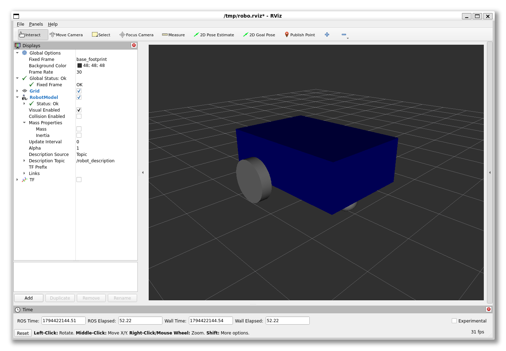
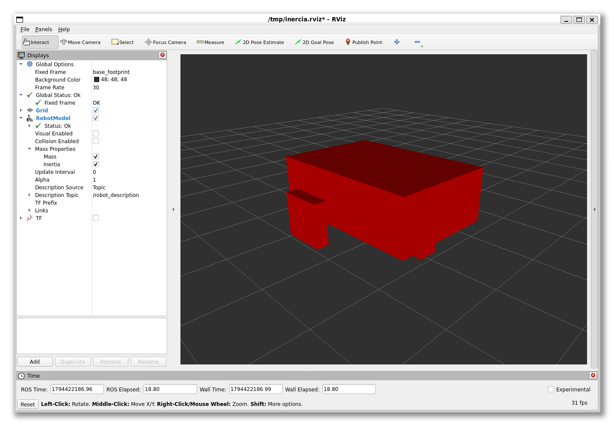

# Inércia das rodas e do caster de um robô

Trabalho para a aula de **Tópicos Avançados em Robótica e Veículos Autônomos**, seguindo o modelo de inércia do chassi apresentado em **09/11/2026**.

O projeto descreve um robô móvel em ROS 2 com URDF/Xacro. Foram adicionadas propriedades de massa, centro de massa e momento de inércia ao chassi, às duas rodas e ao caster, usando macros para caixa, cilindro e esfera.

| Componente | Geometria | Massa |
| --- | --- | ---: |
| Chassi | Caixa | 5 kg |
| Roda esquerda | Cilindro | 1 kg |
| Roda direita | Cilindro | 1 kg |
| Caster | Esfera | 0,5 kg |

## Executar

No Ubuntu com ROS 2 instalado, coloque a pasta `my_robot_description` dentro de `src` do seu workspace e execute na raiz do workspace:

```bash
colcon build --symlink-install --packages-select my_robot_description
source install/setup.bash
ros2 launch my_robot_description display.launch.xml
```

No RViz, use `base_footprint` como **Fixed Frame**. Em **RobotModel → Mass Properties**, habilite **Mass** e **Inertia** para visualizar as propriedades adicionadas.

## Validar

```bash
xacro src/my_robot_description/urdf/my_robot.urdf.xacro -o /tmp/my_robot.urdf
python3 src/my_robot_description/scripts/validar_inercia.py /tmp/my_robot.urdf
```

O teste verifica as massas, os centros de massa e os tensores de inércia dos quatro links físicos. A massa total esperada é **7,5 kg**. A orientação da inércia das rodas acompanha a rotação dos cilindros.

O RViz permite conferir o modelo e suas propriedades. A simulação dinâmica no Gazebo exige também colisões e configuração do simulador.

## Resultado

Capturas reais do projeto executado no RViz com ROS 2 Humble. A compilação, a leitura do URDF e a validação das inércias foram concluídas com sucesso.

Robô com a geometria visual:



Representação das propriedades de massa e inércia:


